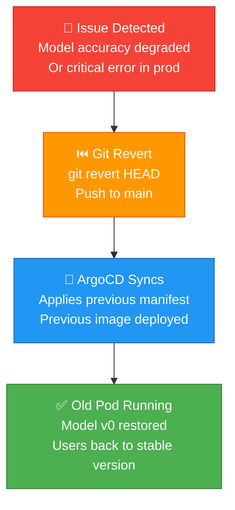
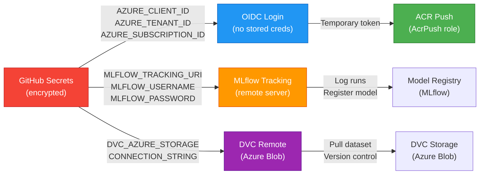

# MLOps Workflow: End-to-End Pipeline

## Complete Flow Diagram

```mermaid
graph TD
    Start([Developer pushes to main]) -->|GitHub Webhook| Trigger["🔔 GitHub Actions Triggered"]
    
    Trigger --> Checkout["📥 Checkout code<br/>actions/checkout"]
    Checkout --> Azure["🔐 Azure Login<br/>OIDC Federated"]
    Azure --> Python["🐍 Setup Python 3.11<br/>Install pip dependencies"]
    
    Python --> Lint["🔍 Lint Code<br/>flake8 src/ tests/"]
    Lint --> LintPass{Lint<br/>Pass?}
    LintPass -->|❌ No| Fail1["❌ Job Failed<br/>Push blocked"]
    LintPass -->|✅ Yes| Test["✅ Run Tests<br/>pytest tests/"]
    
    Test --> TestPass{Tests<br/>Pass?}
    TestPass -->|❌ No| Fail2["❌ Job Failed<br/>Push blocked"]
    TestPass -->|✅ Yes| DVCPull["📦 DVC Pull<br/>Download data from Azure Blob"]
    
    DVCPull --> DVCCheck{Data<br/>Ready?}
    DVCCheck -->|❌ Failed| Fail3["❌ Job Failed<br/>Data unavailable"]
    DVCCheck -->|✅ Yes| Train["🎓 Train Model<br/>python src/train.py"]
    
    Train --> TrainLog["📊 MLflow Logging<br/>params, metrics, artifacts"]
    TrainLog --> TrainOutput["📁 Output Files:<br/>model.pkl<br/>model.pkl.sha256<br/>metadata.json"]
    
    TrainOutput --> Eval["✔️ Evaluate Model<br/>python src/evaluate.py"]
    Eval --> EvalCheck{Accuracy<br/>≥ 90%?}
    
    EvalCheck -->|❌ No| Fail4["❌ Quality Gate Failed<br/>Accuracy below threshold<br/>Build blocked"]
    EvalCheck -->|✅ Yes| EvalPass["✅ Validation Passed<br/>Tag: validation=passed<br/>Set alias: champion=v1"]
    
    EvalPass --> Artifact["📦 Upload Artifact<br/>GitHub artifact: model-bundle<br/>Contains: models/"]
    Artifact --> Download["⬇️ Download Artifact<br/>Setup for Docker build"]
    
    Download --> Verify["🔐 Verify Checksum<br/>Compare model.pkl.sha256<br/>Ensure no corruption"]
    Verify --> VerifyPass{SHA-256<br/>Match?}
    VerifyPass -->|❌ No| Fail5["❌ Checksum Failed<br/>Model corrupted<br/>Build aborted"]
    
    VerifyPass -->|✅ Yes| DockerBuild["🐳 Docker Build<br/>BuildKit with cache<br/>COPY models/model.pkl<br/>COPY models/metadata.json"]
    DockerBuild --> Labels["🏷️  Docker Labels<br/>model_version<br/>mlflow_run_id<br/>git_sha<br/>image_digest"]
    
    Labels --> Trivy["🛡️  Trivy Scan<br/>Vulnerability detection<br/>Fail on HIGH/CRITICAL"]
    Trivy --> TrivyPass{Security<br/>Passed?}
    TrivyPass -->|❌ No| Fail6["❌ Security Scan Failed<br/>Vulnerabilities found"]
    
    TrivyPass -->|✅ Yes| Push["📤 Push to ACR<br/>$ACR_NAME.azurecr.io/ml-model-service:$GIT_SHA"]
    Push --> Digest["🏷️  Get Image Digest<br/>sha256:f1f2f3f4f5f6..."]
    
    Digest --> MLTag["🏷️  Tag MLflow Model<br/>set_model_version_tag<br/>tag=image<br/>value=sha256:f1f2f3f4f5f6..."]
    MLTag --> Kustomize["📝 Update Kustomization<br/>kustomize edit set image<br/>ml-model-service=ACR:GIT_SHA"]
    
    Kustomize --> Commit["💾 Commit Changes<br/>Manifest update [skip ci]<br/>Prevent infinite loop"]
    Commit --> Push2["⬆️  Push to GitHub<br/>k8s/kustomization.yaml"]
    
    Push2 --> ArgoCD["🔄 ArgoCD Detects Change<br/>Watches GitHub repo<br/>Compares desired vs actual"]
    ArgoCD --> ArgoDiff{Sync<br/>Needed?}
    ArgoDiff -->|✅ Yes| ArgoPull["📥 Pull image from ACR"]
    
    ArgoPull --> ArgoRollout["🚀 Rollout Deployment<br/>K8s applies manifest<br/>New pods created<br/>Old pods terminated<br/>Blue-Green strategy"]
    ArgoRollout --> Ready["✅ Pods Ready<br/>Health checks passing<br/>Traffic flowing"]
    
    Ready --> Monitor["📈 Monitor Running Pod<br/>Metrics: accuracy, latency, requests<br/>Logs: predictions, errors"]
    Monitor --> Success["✅ Deployment Complete!<br/>Model v1 running on AKS"]
    
    Fail1 --> End1(["❌ Pipeline Failed"])
    Fail2 --> End1
    Fail3 --> End1
    Fail4 --> End1
    Fail5 --> End1
    Fail6 --> End1
    Success --> End2(["✅ Success"])
    
    style Start fill:#4CAF50,stroke:#2E7D32,color:#fff
    style Success fill:#4CAF50,stroke:#2E7D32,color:#fff
    style End2 fill:#4CAF50,stroke:#2E7D32,color:#fff
    style Fail1 fill:#f44336,stroke:#c62828,color:#fff
    style Fail2 fill:#f44336,stroke:#c62828,color:#fff
    style Fail3 fill:#f44336,stroke:#c62828,color:#fff
    style Fail4 fill:#f44336,stroke:#c62828,color:#fff
    style Fail5 fill:#f44336,stroke:#c62828,color:#fff
    style Fail6 fill:#f44336,stroke:#c62828,color:#fff
    style End1 fill:#f44336,stroke:#c62828,color:#fff
    
    style EvalPass fill:#81C784,stroke:#2E7D32,color:#fff
    style Success fill:#81C784,stroke:#2E7D32,color:#fff
    style TrivyPass fill:#81C784,stroke:#2E7D32,color:#fff
    style VerifyPass fill:#81C784,stroke:#2E7D32,color:#fff
    style ArgoDiff fill:#81C784,stroke:#2E7D32,color:#fff
    
    style Train fill:#2196F3,stroke:#1565C0,color:#fff
    style Eval fill:#2196F3,stroke:#1565C0,color:#fff
    style DockerBuild fill:#FF9800,stroke:#E65100,color:#fff
    style ArgoCD fill:#9C27B0,stroke:#6A1B9A,color:#fff
    style ArgoRollout fill:#9C27B0,stroke:#6A1B9A,color:#fff
```



---

## Phase Breakdown

### Phase 1: **Code Validation** (1-2 min)
```
Developer Push → Lint → Unit Tests → Stop if failed
```
- Flake8 checks code quality
- Pytest runs all tests
- Early failure prevention

### Phase 2: **Data & Training** (5-10 min)
```
DVC Pull → Train Model → MLflow Logging → Quality Gate → Stop if failed
```
- Download exact dataset version via DVC
- Train RandomForest with deterministic split
- Log metrics, params, artifacts to MLflow
- Evaluate.py checks accuracy ≥ 90%
  - ✅ Pass → Tag as champion, allow build
  - ❌ Fail → Block image build (safety gate)

### Phase 3: **Artifact Security** (2-5 min)
```
Upload → Verify Checksum → Stop if corrupted
```
- GitHub actions uploads model-bundle artifact
- Checksum verification prevents corruption
- Only proceed if SHA-256 matches

### Phase 4: **Image Build & Scan** (3-7 min)
```
Docker Build → Trivy Security Scan → Stop if vulnerable
```
- BuildKit compiles Dockerfile
- Embeds model.pkl into image
- Labels with git_sha, model_version, mlflow_run_id
- Trivy scans for CVEs
  - ❌ HIGH/CRITICAL → Block push

### Phase 5: **Registry & Model Tagging** (1-2 min)
```
Push to ACR → Get Digest → Tag MLflow → Update Manifest
```
- Docker push to Azure Container Registry
- Retrieve immutable image digest
- Tag MLflow model version with digest (traceability)
- Update kustomization.yaml with new image

### Phase 6: **GitOps Deployment** (2-5 min)
```
Manifest Commit → ArgoCD Sync → Rollout → Success
```
- Push kustomization change to GitHub [skip ci]
- ArgoCD detects repo change
- Syncs desired state to AKS cluster
- Blue-green rollout (zero downtime)
- Health checks verify pod readiness

### Phase 7: **Monitoring** (Continuous)
```
Pod Running → Metrics Collected → Alerts on issues
```
- Model serving predictions
- Metrics: accuracy, latency, throughput
- Logs aggregated to Azure Monitor
- Alerts trigger if performance degrades

---

## Decision Points & Safety Gates

### ⚡ Critical Decision Points

| Decision | Condition | Pass | Fail |
|----------|-----------|------|------|
| **Lint** | Code style | Continue | ❌ Block |
| **Tests** | Test suite | Continue | ❌ Block |
| **DVC** | Data available | Continue | ❌ Block |
| **Accuracy** | ≥ 90% | Champion ✅ | ❌ Block build |
| **Checksum** | SHA-256 match | Continue | ❌ Abort |
| **Security** | No HIGH CVEs | Push | ❌ Block |
| **ArgoCD** | Manifest valid | Sync | ⚠️  Manual |

---

## Parallel Processes

Some steps run in parallel to speed up the pipeline:

```
┌─ Lint ─┐
├─ Tests ─┤ (All 3 run in parallel)
└─ DVC Pull ┘
   ↓ (All pass, continue to training)
   Train (blocking)
   ↓
   Evaluate (blocking)
   ↓
   Upload Artifact
   ↓
   ┌─ Docker Build ─┐
   ├─ Verify Checksum ─┤ (Could be parallel)
   └─ Security Scan ┘
```

---

## Rollback Strategy

If a deployed model has issues:



**No manual intervention needed** — Git history is the source of truth; revert any commit to roll back instantly.

---

## Environment Variables & Secrets Flow



---

## Timeline Example

```
T+0:00   Push to main
         ↓
T+0:30   ✅ Lint passed
T+1:15   ✅ Tests passed
T+2:00   ✅ DVC data ready (cached, fast)
         ↓
T+7:30   ✅ Training complete (5-10 min varies)
T+8:00   ✅ Evaluation passed (accuracy 96%)
T+8:30   ✅ Model tagged as champion
         ↓
T+9:00   ✅ Artifact uploaded & verified
T+10:00  ✅ Docker image built & scanned
         ↓
T+11:00  ✅ Image pushed to ACR
T+11:30  ✅ MLflow model tagged with digest
T+12:00  ✅ Kustomization updated & committed
         ↓
T+12:30  🔄 ArgoCD syncing...
T+14:00  ✅ New pods deployed & healthy
         ↓
T+14:30  🚀 MODEL LIVE IN PRODUCTION

Total: ~14.5 minutes end-to-end
```

---

## Common Interview Questions & Answers

### Q: What triggers the pipeline?
**A:** Any push to the main branch triggers GitHub Actions webhook. The workflow runs:
1. Code validation (lint, tests)
2. Training with MLflow (logged to experiment tracking)
3. Quality gate (accuracy ≥ 90%)
4. Docker build with model embedded
5. Push to ACR
6. GitOps sync to AKS via ArgoCD

### Q: How do you prevent bad models from deploying?
**A:** Multiple gates:
- **Accuracy gate**: evaluate.py raises ValueError if accuracy < 90%, fails the job
- **Checksum verification**: SHA-256 confirms model.pkl wasn't corrupted
- **Security scan**: Trivy blocks push if CVEs found
- **ArgoCD validation**: Invalid manifests don't sync

### Q: How do you track which data/code trained the model?
**A:** metadata.json embeds:
- `git_sha` — exact commit that trained it
- `data_sha256` — exact data version (via DVC)
- `mlflow_run_id` — link to experiment tracking
- Image digest ties pod back to metadata

### Q: How do you rollback a bad deployment?
**A:** `git revert HEAD` → push → ArgoCD syncs previous manifest → old model running. No manual intervention.

### Q: How does DVC fit in?
**A:** DVC tracks dataset versions in Azure Blob. `dvc pull` in pipeline downloads exact data version. `data/iris.csv.dvc` (git-tracked) points to Azure storage. Reproducible training without storing large files in Git.

### Q: Why embed model.pkl in Docker image?
**A:** 
- Model is immutable once container runs
- Version = image digest (unique per build)
- Fast startup (no download)
- Easy rollback (point to previous image)
- Scaling is effortless (all replicas have same model)

### Q: What if training takes too long?
**A:** 
- Parallelize with `dvc repro --jobs N`
- Cache frequently-reused data layers
- Use GPU nodes for training
- Timeout safeguards prevent hanging

### Q: How do you monitor production?
**A:** 
- MLflow logs historical metrics
- Running pods expose `/health` and `/version`
- Kubernetes metrics (latency, throughput)
- Azure Monitor aggregates logs
- Alerts trigger on degraded accuracy or errors

---

## Integration Points with Teams

| Team | Role | Tools |
|------|------|-------|
| **Data** | Prepares datasets | DVC, Azure Blob |
| **ML Eng** | Trains models | train.py, MLflow, evaluate.py |
| **DevOps** | Manages infrastructure | Terraform/Bicep, AKS, ACR, ArgoCD |
| **Platform** | Owns pipeline | GitHub Actions, kustomize, helm |
| **Monitoring** | Alerts & dashboards | Azure Monitor, Grafana, DataDog |

---

## Key Metrics to Track

```
📊 Pipeline Metrics:
   - Total runtime (target: < 20 min)
   - Success rate (target: > 95%)
   - Model accuracy (monitor trend)
   - Deployment frequency (target: daily)

🚀 Production Metrics:
   - P95 latency (< 100ms)
   - Throughput (requests/sec)
   - Error rate (< 0.1%)
   - Model drift (detect data shift)

🔐 Security Metrics:
   - CVEs found by Trivy
   - Failed security scans
   - Checksum mismatches
   - Access audit logs
```

